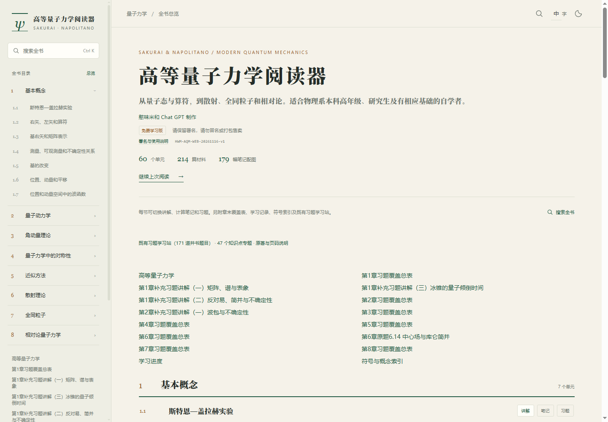
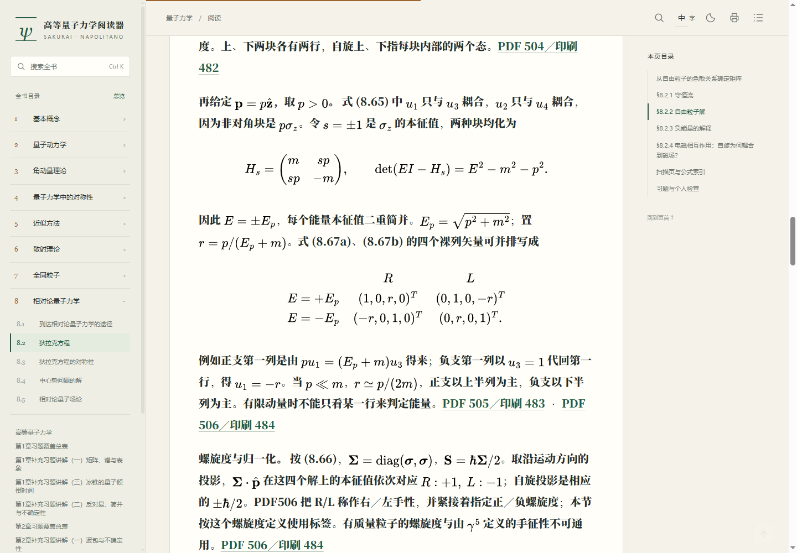

# 高等量子力学阅读器 · Windows 加密离线版

**面向物理系本科高年级学生、研究生，以及有线性代数、微积分和量子力学基础的自学者。**

从量子态与算符出发，依次学习量子动力学、角动量、对称性、近似方法、散射、全同粒子和相对论量子力学。阅读器把中文讲解、计算笔记、配套习题和参考材料放在同一个离线界面中，便于按章学习、对照推导和查找概念。

**憨味米和 Chat GPT 制作。** 主线依据 J. J. Sakurai（樱井纯）、Jim Napolitano（拿波里塔诺）《现代量子力学（原书第3版）》中文版整理。本项目含 AI 辅助内容，是非官方学习资料；请结合原著、课程要求和自己的推导使用。

**[下载 Windows 完整离线 App v1.0.1](https://github.com/HWMiiii/advanced-quantum-mechanics-notes/releases/download/app-v1.0.1/Advanced-Quantum-Mechanics-Reader-v1.0.1-win-x64.zip)** · [v1.0.1 发布说明](https://github.com/HWMiiii/advanced-quantum-mechanics-notes/releases/tag/app-v1.0.1) · [使用说明](docs/USAGE.md) · [常见问题](docs/FAQ.md) · [验收记录](docs/VALIDATION.md)

本项目现以加密离线 App 发行。当前分支中的 Obsidian 笔记目录与旧 Obsidian Release 已撤下；下载请使用 Release 附件中的完整 App ZIP。



## 怎样使用这套资料

- **配合课程学习**：先读本节讲解，理清物理对象、符号约定和适用条件，再切换到计算笔记与习题。
- **复习与查阅**：用目录和全文搜索定位概念，在同节材料、上下节和引用段落之间来回对照。
- **自学与验算**：保留自己的推导过程，对原书题目、补充计算和待核对项分别判断；不要把已有解答当成免于检查的标准答案。

学习记录与历史快照按原资料保留。**材料准备完成不表示你已经阅读、作答或掌握，也不表示每一处数学论断都已校勘无误。**

## 内容范围

主笔记覆盖 **8 章、60 节、214 篇材料**，配有 **179 幅笔记图片和 303 项附件**。

| 章节 | 节数 | 主要内容 |
|---|---:|---|
| 1 · 基本概念 | 7 | 态矢量、算符、测量、表象、位置与动量 |
| 2 · 量子动力学 | 7 | 时间演化、绘景、简谐振子、传播子与规范变换 |
| 3 · 角动量理论 | 11 | 旋转、自旋、密度算符、角动量叠加与张量算符 |
| 4 · 量子力学中的对称性 | 4 | 守恒与简并、宇称、晶格平移和时间反演 |
| 5 · 近似方法 | 9 | 微扰论、精细结构、变分法、含时过程与辐射 |
| 6 · 散射理论 | 9 | 散射振幅、玻恩近似、分波、共振及非弹性散射 |
| 7 · 全同粒子 | 8 | 置换对称性、多粒子态、氦原子、量子场与电磁场量子化 |
| 8 · 相对论量子力学 | 5 | 相对论方程、狄拉克理论、中心势与量子场论入门 |

| 材料类型 | 数量 |
|---|---:|
| 讲解 | 60 篇 |
| 计算笔记与概念辨析 | 60 篇 |
| 配套习题材料 | 75 篇 |
| 补充材料 | 3 篇 |
| 索引、覆盖表与历史记录 | 16 篇 |

“75 篇习题材料”是页面数量，不是全书原题总数；具体原题、小问和未决事项以各页及章末覆盖表为准。

另外保留既有学习站中按井孝功、郑仰东《高等量子力学习题解答》正文编号整理的 **171 道习题、47 个知识点专题**，以及 **20 份附录 PDF**（原站 15 份、本地田光善讲义 5 份）。来源和整理状态继续保留原标注。计算程序与数据以只读资料页提供，不会自动执行。

**整本主教材 PDF 不随 App 分发。** 第一次点击教材页码时，选择自己使用的第三版中文 PDF。以后点击讲义的页码即可查看对应原页。历史单文件阅读页中的第2版参考入口，不能用于替代第3版主笔记的页码。

## 阅读功能

- **中文目录与导航**：按章、按节阅读，在讲解、计算笔记和习题之间切换。
- **全文搜索**：`Ctrl+K` 或搜索按钮；搜索覆盖主笔记、补充习题和专题，共 432 个检索条目。
- **离线数学排版**：主笔记 39,861 处公式预排为本地矢量图像；补充站随包提供 KaTeX 与字体，公式显示不依赖网络。
- **图片与引用**：图片放大、页内目录、内部链接与已存在的段落锚点；引用原著的公式编号保留原约定。
- **阅读设置**：首页的“继续上次阅读”会回到上次读到的段落。亮暗主题、正文字号和自测勾选保存在本机。
- **做题与自测**　171 道补充题各有可搜索的“本题第一步”。本版修复了 69 道题中的 131 处公式。讲义与习题共有 1,467 项可勾选自测，重新打开阅读器后仍可查看。
- **正常摘录与打印**：保留复制、截图和打印；阅读页与打印页保留“憨味米和 Chat GPT 制作”及版本信息。
- **版本与校验**：启动时检查发行文件与内容；上方按钮或 `Alt+V` 可重新校验。



## 下载和运行

1. 前往 [最新 Release](https://github.com/HWMiiii/advanced-quantum-mechanics-notes/releases/latest)，下载 **`Advanced-Quantum-Mechanics-Reader-v1.0.1-win-x64.zip`** 和 `SHA256SUMS.txt`。
2. **完整解压**到自己拥有的本地文件夹；不要在压缩软件预览窗口内运行，也不要从 UNC 网络共享路径启动。
3. 双击 **`高等量子力学阅读器.exe`**，等待启动校验结束。
4. 保留同目录下的 `runtime`、DLL、配置、签名与许可文件。分享给朋友时发送完整 ZIP，不能只发送 EXE。

GitHub 的 **Source code (zip / tar.gz)** 是本仓库说明文件的快照，**不是阅读器安装包**。下载包使用英文文件名，解压后程序和界面均为中文。

| 项目 | 要求或说明 |
|---|---|
| 操作系统 | Windows 10 / Windows 11，x64 |
| 系统组件 | .NET Framework 4.8，或兼容的 4.8.1 |
| 离线运行组件 | 已附 WebView2 Fixed Runtime 157.0.4341.60 x64 |
| 建议资源 | 至少 8 GB 内存、2 GB 可用磁盘空间 |
| Obsidian | 无需安装 |
| 网络 | 正常阅读、搜索及公式显示无需联网 |
| 本机实测 | Windows 10 22H2，19045.6093，x64，.NET 4.8.1 |

本包没有包含 .NET 系统组件安装器。Windows 11、其他电脑和 ARM64 尚未实机验证；未提供 macOS/Linux 原生程序。固定版 WebView2 随 App 发行，不会自动升级，后续更新需要重新下载相应版本。

程序没有受信任的 Windows 发布者代码签名。遇到“未知发布者”提示时，请先核对仓库、Release 和文件指纹；不要把内容签名当成 Windows 发布者证书。

## v1.0.1 版本和校验

| 项目 | 值 |
|---|---|
| GitHub 发布标签 | `app-v1.0.1` |
| App | `1.0.1 / HWM-AQM-APP-v1.0.1` |
| 内容版本 | `HWM-AQM-WEB-20261116-v1`，修订于 2026-11-20 |
| ZIP 大小 | **490,291,660 字节**，约 490 MB / 467.6 MiB |
| 文件名 | `Advanced-Quantum-Mechanics-Reader-v1.0.1-win-x64.zip` |

ZIP SHA-256：

```text
ab50fb669a2d41261b1bdbf4feab2e979dc177b606ab0e0c79431bfb5c22a34c
```

可在下载目录用 PowerShell 核对：

```powershell
Get-FileHash -LiteralPath '.\Advanced-Quantum-Mechanics-Reader-v1.0.1-win-x64.zip' -Algorithm SHA256
```

比对 [SHA256SUMS.txt](SHA256SUMS.txt) 和本版本发布记录。另附 [发行文件清单](verification/版本清单.json)、[签名](verification/版本签名.sig)、[公开校验公钥](verification/版本校验公钥.pem) 和 [内容范围清单](verification/内容范围清单.json)。SHA-256 核对字节是否一致，不能单独证明发布者身份。

## 加密封装与使用边界

发行包使用独立产品标识、独立内容密钥和 RSA-3072 签名密钥。程序启动先验证发行签名、文件指纹、加密认证与内容签名，再通过内存提供阅读资源。当前发行包不直接附原始 Markdown、明文网页目录、制作源码、签名私钥或测试调试资料。

客户端必须能够解密内容，因此专业逆向、内存提取、正常摘录、截图和打印仍可能取得资料。**加密不能完全阻止提取或转售；本项目不宣称“无法复制”或“不可破解”。**

App 使用独立的临时会话，不使用或修改个人浏览器资料。正常退出等待 WebView2 `BrowserProcessExited` 后再清理本次会话；无法确认归属、超时或文件仍被占用时保留以便重试，归属标记最后删除。操作系统分页、崩溃转储、截图和打印等仍可能留下痕迹，不能承诺绝对零磁盘痕迹。

本仓库现用于 App 发布、说明与问题反馈，不发布应用构建源码。旧 Obsidian 发布入口与当前分支的笔记已撤下，**但这不保证历史提交、缓存、他人克隆或已经下载的旧副本消失，更不能让旧副本远程失效**。

## 验收范围

v1.0.1 在断网环境中连续启动了三次，核对了自测勾选、续读位置和本地教材的恢复及移除。171 道补充题的 2,309 个解答公式均已打开检查。分享 ZIP 在全新位置解压后，正式程序验证了 277 个发行文件及 23,952 项内容资源的指纹，并实际从首页搜到了补充题 1.3。[完整验收记录](docs/VALIDATION.md)

## 问题反馈和勘误

请通过 [Issues](https://github.com/HWMiiii/advanced-quantum-mechanics-notes/issues/new/choose) 提交运行问题或内容勘误。

- 运行问题：App/内容版本、Windows 版本、所在章节、操作步骤、预期与实际结果，附必要截图或错误文字。
- 数学或文字勘误：章节、页面标题、公式编号或原书页码、具体问题、建议修改与依据；区分原书、学习讲解和软件排版问题。

## 署名与资料权利

**憨味米和 Chat GPT 制作。免费学习，请保留署名，请勿冒名或打包售卖。**

原著、原图、习题、第三方讲义及软件组件的权利归各自权利人。学习整理和加密封装不改变权利归属，不代表作者、出版社或微软的官方授权或背书，也不授予第三方出版或商业使用权。

本项目没有把整部原著或整套学习资料置于 MIT、CC 等开放许可之下。软件运行组件分别遵守随包官方许可。详见 [署名与使用边界](COPYING.md) 和 [运行组件说明](docs/RUNTIME-NOTICES.txt)。

建议引用：

> 《高等量子力学阅读器》，憨味米和 Chat GPT 制作；主线依据 J. J. Sakurai、Jim Napolitano《现代量子力学（原书第3版）》中文版；内容 HWM-AQM-WEB-20261116-v1，2026-11-20 修订，App v1.0.1。
