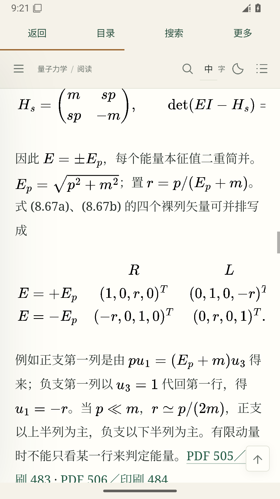

# 安卓离线版 v1.0.1

**憨味米和 Chat GPT 制作。** 2026-11-28 首次发布安卓版，沿用 Windows v1.0.1 的学习内容（2026-11-20 修订），另做手机布局、Android PDF 和打印适配。

**[直接下载 APK](https://github.com/HWMiiii/advanced-quantum-mechanics-notes/releases/download/android-v1.0.1/Advanced-Quantum-Mechanics-Reader-v1.0.1-Android.apk)** · [对应 Release](https://github.com/HWMiiii/advanced-quantum-mechanics-notes/releases/tag/android-v1.0.1) · [返回项目介绍](../README.md)

## 适合谁、包含什么

面向物理系本科高年级学生、研究生，以及具有线性代数、微积分和量子力学基础的自学者。主线依据 J. J. Sakurai（樱井纯）、Jim Napolitano《现代量子力学（原书第3版）》中文版整理，是非官方、AI 辅助学习资料。

覆盖 8 章、60 节、214 篇主站材料、179 幅笔记图片、303 项附件；保留补充学习站的 171 道习题、47 个知识点专题和 20 份附录 PDF。各材料的来源、历史记录和待核对项按原资料保留。整本主教材 PDF 不随包分发。

支持中文目录、同节讲解/笔记/习题切换、432 个条目的全文搜索、图片放大、脚注、内部链接、亮暗主题、字号、横屏、续读和 1,467 项自测勾选。171 道补充题保留各自的“本题第一步”。主站公式以本地矢量图像显示，补充站使用随包的 KaTeX 和字体，无需联网排版。宽公式可在公式区域横向滑动。

**材料准备完成不表示读者已经学会；软件验收不等于数学内容全部正确。** 请配合原著、课程和自己的推导使用。

## 安装

1. 手机系统需为 **Android 8.0 或更新版本**，并启用 **Android System WebView 124 或更新版本**。该组件通常随系统安装；若组件缺失、停用或太旧，App 会提示先处理系统组件。组件更新本身需要另行下载，之后正常阅读可以全程断网。
2. 下载 Release 附件 **`Advanced-Quantum-Mechanics-Reader-v1.0.1-Android.apk`**。不需要下载 ZIP、源码包、Obsidian 或 Windows 运行组件。
3. 在手机文件管理器中打开 APK，按系统提示允许该文件管理器安装应用，然后安装。本项目没有上架应用商店；请核对下载仓库和下面的文件指纹。
4. 打开“高等量子力学”，等待启动内容校验。APK 已包含阅读资料和数学排版资源；建议至少预留 500 MB 可用存储。

APK 不包含本项目的原生 ABI 库，同一安装文件可供兼容的 ARM/ARM64/x86/x64 Android 使用；**本轮实际测试的是 x86_64 Android 15 模拟器，不能据此声称所有实体机型均已验证。**

## 阅读、PDF 与打印

- 顶部“目录”回到全书；“搜索”打开检索；正文上方可换字号、主题、同节材料。底部系统返回键先关闭图片/目录，再返回上一页面。
- “更多 → 版本与校验”重新检查内容。“更多 → 使用说明”可查看署名、用途和保护边界。
- 首次点击主教材页码或使用“更多 → 关联教材 PDF”，选择自己已下载的第三版中文 PDF。App 通过 Android 文件选择器记住授权位置，文件留在原处，不上传、不复制整本教材。可翻页、输入页码、双指缩放；页面标的是 **PDF 页码**，不要与印刷页码混用。
- 附录内置 PDF 在 App 内显示。教材关联页可以更换或取消关联；移动/删除原 PDF、撤销访问授权后需要重新选择。
- “更多 → 打印本页”使用 Android 系统打印界面，也可选择“另存为 PDF”。正文和页脚保留署名与安卓版本。实体打印机、厂商打印服务未在本轮测试。
- 阅读位置、自测勾选和显示设置保存在本 App 的独立数据区，不与 Windows 自动同步。正常退出保留学习记录；卸载或清除应用数据会删除这些记录。请勿把“清除数据”当作普通退出。

## 版本与校验

| 项目 | 本版值 |
|---|---|
| Android 版本 / GitHub 标签 | `1.0.1` / `android-v1.0.1` |
| 包名 | `cn.hanweimi.aqm.android` |
| 系统最低版本 / 目标版本 | API 26 / API 35 |
| 内容版本 | `HWM-AQM-WEB-20261116-v1`，2026-11-20 修订 |
| 安卓适配日期 | 2026-11-28 |
| APK 大小 | 166,122,024 字节，约 166.1 MB / 158.4 MiB |
| 加密资源 | 23,955 项；含原内容的全部 23,953 项资源及 2 项手机适配资源 |

APK SHA-256：

```text
7afdd639526e38736c7fbb0f9bf8f132aca1f7567a6bc07bfd974f8d7ee95dc6
```

APK 安装签名证书 SHA-256：

```text
eae77da14c1ce97f7be355291f98a65aaeb400952258d3b2e9b655e75fac1d5b
```

在 Windows 下载目录可运行：

```powershell
Get-FileHash -LiteralPath '.\Advanced-Quantum-Mechanics-Reader-v1.0.1-Android.apk' -Algorithm SHA256
```

Release 仅附 APK。公开内容校验公钥、资源清单及签名也在 APK 内：`assets/content-public.pem`、`assets/content-index.json`、`assets/content-index.sig`；加密内容为 `assets/content.aqm`。这些是可直接从 APK ZIP 容器读取的公开验证材料，不包含内容签名私钥或 APK 升级私钥。

**APK 安装签名与内容签名是两件事。** APK v2/v3 签名供 Android 检查安装文件和后续更新身份；独立 RSA-3072 内容签名认证资源索引，配合整包 SHA-256、分块 AES-256-GCM 和资源指纹在启动及读取时校验。它们不等于 Windows 发布者代码签名，也不代表 Google、作者或出版社的认证。SHA-256 本身不能独立证明发布者身份。

## 离线、署名与保护边界

APK 没有互联网或广泛存储权限，不包含明文 Markdown/网页目录、制作源码、私钥或测试工具。内容按需在内存解密，内置 PDF 通过内存读取；不把整套明文网页解压到普通临时目录。Android 使用自身系统 WebView，与 Windows 随包附带固定版 WebView2 的方案不同。

外部参考链接需经确认后交给手机浏览器打开，届时浏览器可能联网。PDF 只读取用户通过系统选择器授权的文件。阅读数据保存在独立应用数据区，不使用个人浏览器资料；系统缓存、分页、截图、打印或崩溃记录仍可能留下痕迹，不能承诺零磁盘痕迹。

支持正常摘录、截图和打印。客户端必须能够解密，因此加密不能彻底防止逆向、提取或转售，**也不能使此前已经公开或被下载的旧副本失效**。

免费学习，请保留“憨味米和 Chat GPT 制作”，请勿冒名或打包售卖。原著、原图、第三方讲义和软件的权利归各自权利人；未把整部原著或整套资料置于 MIT/CC 许可之下。随内容保留 KaTeX、MathJax、markdown-it、markdown-it-footnote、YAML 的原许可；Android/System WebView 的系统组件许可由系统提供，本 APK 不重新分发系统 WebView。[完整使用边界](../COPYING.md)

## 本轮实测

环境：本机 Android 15 / API 35 / x86_64 模拟器，1080×1920；System WebView 124.0.6367.219。关闭模拟器 Wi-Fi 和移动数据后完成安装包的实际运行测试。

| 检查 | 结果 |
|---|---|
| 正式 APK 安装、启动校验、断网运行 | 通过 |
| 手机目录、同节材料切换、全文搜索、内部链接、脚注往返、图片放大 | 通过 |
| 狄拉克方程复杂公式、宽公式局部横向滑动、亮暗主题、字号与横屏 | 通过 |
| 171 道补充题 | 2,309 个解答公式、171 个第一步提示，未发现 KaTeX 渲染错误 |
| 47 个知识点专题 | 1,117 个数学排版实例，未发现 KaTeX 渲染错误 |
| 完全结束进程后重启 | 续读位置、自测勾选、主题和字号恢复 |
| 内置 PDF | 内存读取、翻页、直接跳页、返回正文通过 |
| 用户本地 PDF | 用独立的 600 页合成测试文件完成系统选择、23 页跳转、重启后打开、取消关联；未改动原文件 |
| Android 系统打印 | 实际保存 9 页 PDF，逐页提取检查均有制作署名和安卓版本；预览可正常显示 |
| 版本与校验入口 | 正式界面可点击并完成校验 |
| 修改内容 / 修改内容签名 | 两种样本都保留有效 APK 安装签名；实际安装后均被启动内容校验拒绝，未创建阅读视图 |
| 封装全量检查 | 23,955 项资源、24,269 个认证块的认证、解压长度和 SHA-256 均通过；原 23,953 项资源全部保留 |
| APK 审查 | ZIP CRC、对齐、v2/v3 安装签名通过；无调试模式、测试入口、互联网权限、明文笔记或签名私钥 |




以上是软件与封装验收。尚未实测实体手机、其他 Android 版本、厂商定制系统、电子墨水设备和实体打印机；不把验收通过写成数学内容全部无误。原笔记、教材和 Windows 成品的 810 个基线文件指纹均与制作前一致。
